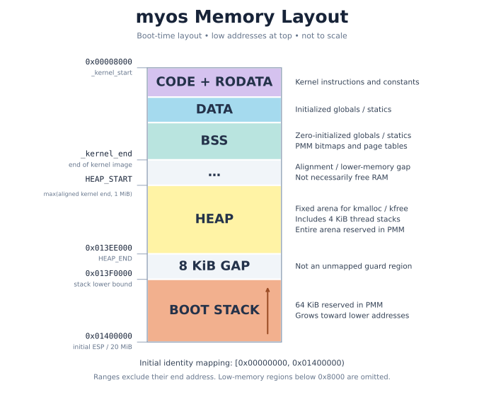

# 일단 대가리 박고 시작하는 커널(운영체제) 만들기

> 만들다보면 이해가 가겠지~ (26.05.01)
>
> 내가 얼마나 멍청한지 알려주는 플젝 (26.10.17)

## 실행하는 법
```
make clean
make
make run
```

## 메모리 배치



## 개발 현황

> 부팅, 인터럽트, 기본 드라이버, 메모리 관리와 커널 라이브러리
> 
> 현재 커널 스레드 작업 중

- [개발 과정 및 구현 계획](docs/development.md)
- [알려진 문제 및 개선 과제](https://github.com/nuguri03/myos/issues)